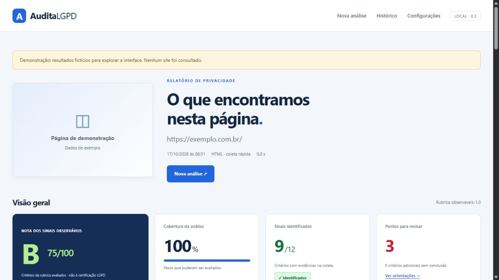
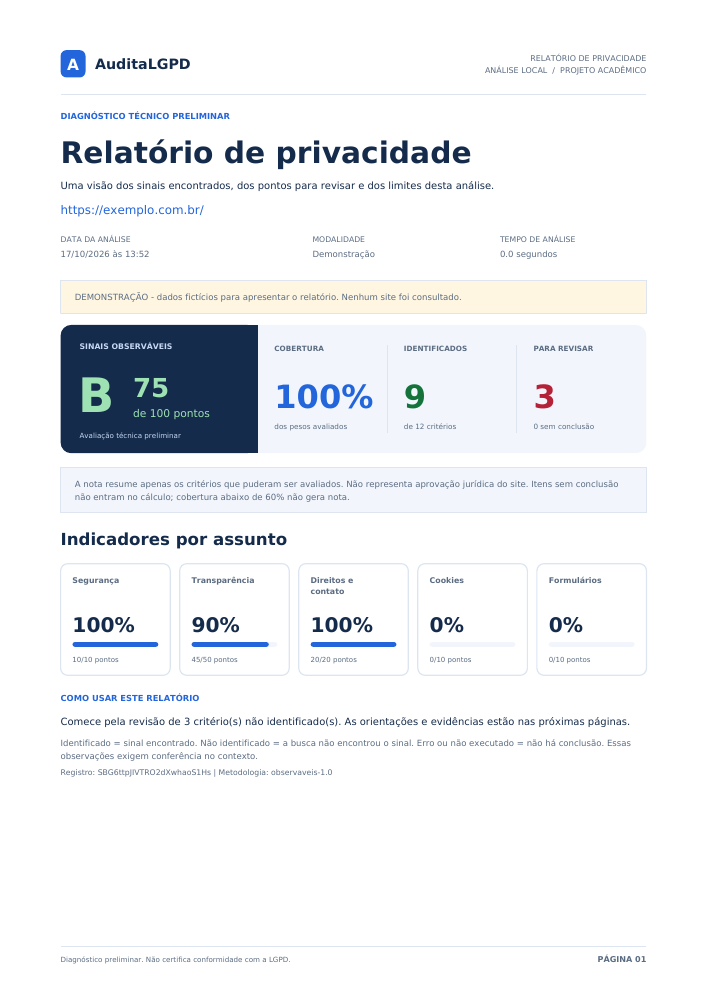

# AuditaLGPD

Aplicação web local para diagnóstico técnico preliminar de sinais de privacidade em páginas públicas. Projeto acadêmico de TCC desenvolvido com Python, Flask, Selenium, Beautiful Soup, SQLite e ReportLab. Interpretação de políticas opcional com Google Gemini.

**A nota mede sinais observáveis segundo uma rubrica acadêmica. Não certifica conformidade com a LGPD.** Processos internos e a validade jurídica dos tratamentos exigem avaliação humana.



## Recursos da versão 0.2

- Interface com nota A–E, indicadores por assunto, cobertura, evidências e orientações de melhoria.
- Coleta rápida de HTML ou coleta dinâmica com Selenium em Edge/Chrome local, com perfil temporário e captura de tela.
- Observação de cookies antes de interação: nome, domínio e atributos, sem guardar valores. Domínios são derivados dos eventos da página atual; tráfego de inicialização do navegador é excluído.
- Identificação heurística de HTTPS, avisos, formulários, política e sete temas de transparência.
- Rubrica de 12 critérios, pesos somando 100, versão gravada com cada análise e cobertura mínima de 60% para nota.
- Interpretação opcional pelo Gemini, com resposta estruturada e descarte de citações que não existam no texto enviado. A IA não altera a nota.
- Progresso por etapa, uma coleta de cada vez, histórico SQLite e PDF com capa visual, nota, indicadores, estados em cores, evidências e limitações.
- Chave Gemini informada pela interface mantida somente na memória desta execução, nunca no GitHub. Preferências sem segredo ficam em `instance/preferences.json`.

Os estados **Identificado** (verde), **Não identificado** (vermelho), **Erro** (laranja) e **Não executado** (cinza) descrevem detecção. Identificar um formulário ou cookie não é aprová-lo juridicamente. Erro de conexão não recebe nota como se fosse página vazia.

Leia [metodologia e referências](docs/metodologia.md) para os pesos, limiares, bases consultadas e limitações. [Cookiebot](https://www.cookiebot.com/en/cookie-checker/) e [CookieYes](https://www.cookieyes.com/cookie-scanner/) foram pesquisados como referências de inventário e relatório; [GTmetrix](https://gtmetrix.com/) foi referência de organização visual. Não houve validação comparativa de precisão nem cópia de marcas/ativos.

## Executar no Windows

Pré-requisitos: Python 3.11+, Git e Edge ou Chrome instalado para a coleta dinâmica.

```powershell
py -3 -m venv .venv
.\.venv\Scripts\python.exe -m pip install -r requirements-lock.txt
.\.venv\Scripts\python.exe -m pip install --no-deps -e .
.\.venv\Scripts\python.exe -m flask --app auditalgpd run --host 127.0.0.1 --port 5000
```

Abra [a aplicação local](http://127.0.0.1:5000/). Também é possível iniciar com `iniciar.cmd` após a instalação. Para atualizar uma instalação existente, execute os dois comandos de instalação e reinicie o servidor (`Ctrl+C` na janela antiga, depois `iniciar.cmd`).

Linux/macOS: substitua o executável por `.venv/bin/python` e crie o ambiente com `python3 -m venv .venv`. Escolha Chrome se Edge não estiver instalado. O navegador completo foi validado manualmente em Windows/Edge; a suíte offline cobre Linux/Windows no CI.

O Selenium Manager pode baixar o driver oficial na primeira execução, em `instance/selenium`. A internet continua necessária para analisar sites externos. O perfil temporário é encerrado ao fim da coleta; nenhum perfil pessoal é utilizado.

## Como usar

1. Abra **Configurações** e selecione o navegador instalado.
2. Informe a página pública e escolha **Análise simples** ou **Análise avançada**. A simples consulta o HTML; a avançada também observa o conteúdo carregado no navegador e registra cookies/captura.
3. Confirme a autorização para analisar e inicie.
4. Confira nota/cobertura, evidências, sugestões e os critérios ainda pendentes.
5. Exporte PDF ou consulte o histórico. A demonstração usa dados fictícios e não consulta sites.

O PDF segue a identidade visual da aplicação, com fontes incorporadas, cabeçalho/rodapé, indicadores na primeira página e tabelas com cabeçalhos repetidos quando ocupam mais de uma página. Evidências e registros históricos são preservados; a apresentação usa linguagem simples para as modalidades de análise.



### Ativar Gemini

Em **Configurações**, informe uma chave do seu projeto no [Google AI Studio](https://aistudio.google.com/api-keys) e um [modelo disponível](https://ai.google.dev/gemini-api/docs/models). O padrão configurável é `gemini-3.5-flash-lite`, consultado na documentação oficial em 17/10/2026. Não cole a chave em issues, commits ou mensagens.

A chave digitada fica na memória do processo Flask e precisa ser informada novamente depois de encerrá-lo. É possível fornecer `GEMINI_API_KEY` e `GEMINI_MODEL` por variáveis de ambiente; o aplicativo não carrega `.env` automaticamente. O campo da chave nunca é preenchido de volta na interface.

Marque **Incluir interpretação com Gemini** a cada análise. Isso envia ao Google até 24.000 caracteres do texto da política, com remoção básica de e-mails, CPFs e telefones. Essa remoção não garante anonimização completa. Imagens, cookies e valores de formulários não são enviados. A política inteira pode exceder o limite; a interface informa truncamento.

O Gemini é externo: o processamento por IA não ocorre no computador. Aplicam-se as condições de dados, cotas e eventual cobrança do projeto Google. Sem chave/ativação, não há chamada ao provedor. Não há novas tentativas automáticas de consumo de cota. A integração foi validada com respostas simuladas; o uso real depende de uma chave e modelo disponíveis na conta do usuário.

## Escopo e controles

- Uso individual em `127.0.0.1`; não publique o servidor Flask na rede. Não há autenticação/múltiplos usuários.
- Uma página e até uma política da mesma origem (até três candidatos). Não é rastreamento do domínio inteiro. A política usa o mesmo modo de coleta escolhido.
- HTTP: DNS público validado, IP fixado por conexão, redirecionamentos revalidados, TLS padrão, até 2 MB de HTML e orçamento de 20 segundos.
- Selenium: processo separado com limite de 65 segundos por coleta, perfil temporário, download de arquivos negado, TLS mantido e saída por proxy local. O proxy valida DNS/conecta ao IP aprovado, restringe portas e tem limites de conexões e tráfego de 20 MB. Pode bloquear recursos e reduzir a completude. É uma redução de risco, não isolamento de sistema operacional.
- A captura dinâmica aguarda o carregamento e observa por mais três segundos. Conteúdo tardio, interações, iframes especiais e shadow DOM podem não ser analisados integralmente.
- Não clica em escolhas de consentimento, não preenche/envia formulários, não usa login e não classifica automaticamente todos os rastreadores/cookies. Rejeição/revogação e bloqueio antes do consentimento continuam pendentes de validação.
- O HTML integral e valores de campos não são persistidos. URLs no histórico excluem query, fragmento e credenciais; caminhos ainda podem conter identificadores. Evidências textuais e capturas públicas podem conter dados: proteja seus arquivos locais. O SQLite não é criptografado.
- `instance/`, `.env`, banco, perfis e caches são ignorados pelo Git. Publicar código não publica o histórico. A chave de sessão é aleatória por execução; opcionalmente defina `AUDITALGPD_SECRET_KEY` no ambiente para mantê-la estável.
- A fila e o progresso são locais e em memória. Reiniciar o aplicativo interrompe tarefas pendentes; relatórios já salvos permanecem no SQLite.

## Testes

```powershell
.\.venv\Scripts\python.exe -m unittest discover -v
```

A suíte não requer API Gemini nem sites externos. Cobre URL/DNS/redirecionamentos, proxy, remoção de valores de cookies, rubrica/cobertura, citações inventadas, chave fora do disco/HTML, CSRF, progresso/concorrência, persistência e PDF. O workflow `.github/workflows/tests.yml` usa Linux/Windows e Python 3.11/3.12.

Teste manual opt-in com navegador real (pode baixar o driver):

```powershell
.\.venv\Scripts\python.exe tools/smoke_browser.py
```

Ele injeta um transporte exclusivo de teste para uma fixture local: insere um banner via JavaScript, grava um cookie fictício e verifica DOM renderizado, controles, captura e remoção de valores. Esse redirecionamento de teste não existe na configuração da aplicação. Também foi concluída uma coleta externa real de `https://example.com/` com resposta HTTP 200, captura e exclusão do tráfego de inicialização do Edge.

## Organização

`audit.py` orquestra a coleta; `security.py` faz a coleta HTTP; `browser*.py` isolam Selenium/proxy; `detectors.py` e `assessment.py` produzem evidências/rubrica; `gemini.py` interpreta trechos; `jobs.py` organiza progresso; `settings.py` mantém preferências; `storage.py` persiste; `reports.py` gera PDF; `web.py`, `templates/` e `static/` oferecem a interface.

Consulte [arquitetura](docs/arquitetura.md), [roteiro de evolução](docs/ROADMAP.md) e [registro de desenvolvimento](docs/desenvolvimento.md).

MIT. Projeto acadêmico em evolução; resultados de experimentos de precisão ainda precisam ser produzidos para o TCC.
