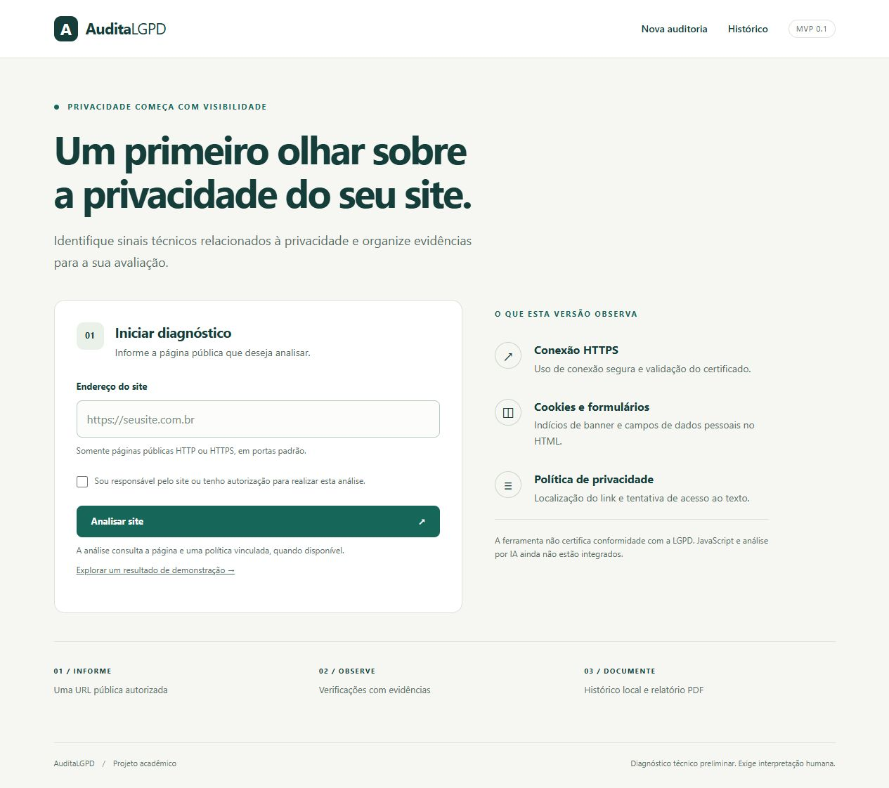

# AuditaLGPD

Ferramenta web acadêmica para diagnóstico técnico preliminar de sinais de privacidade em páginas públicas. Primeira implementação do projeto de TCC, com Python, Flask, Beautiful Soup, SQLite e ReportLab.

**A ferramenta não certifica conformidade com a LGPD e não substitui avaliação humana.** Os resultados descrevem o HTML observado em uma consulta; não são pareceres jurídicos.



## O que já funciona

| Recurso | Situação nesta versão |
| --- | --- |
| Entrada e validação de URL pública | Implementado |
| HTTPS com validação do certificado TLS | Implementado |
| Indícios de banner de cookies no HTML estático | Implementado, por heurística |
| Indícios de campos de dados pessoais em formulários | Implementado, sem preencher ou enviar |
| Localização de link de política de privacidade | Implementado, por texto do link |
| Recuperação do texto de uma política da mesma origem | Implementado; não avalia o significado do texto |
| Histórico local em SQLite e relatório PDF | Implementado |
| Página de demonstração sem acesso à rede | Implementado, explicitamente identificada |
| Selenium, execução de JavaScript e teste de consentimento | Planejado |
| Avaliação de políticas com LLM | Planejado; nenhum provedor de IA é chamado |
| Contas, separação de usuários e implantação pública | Fora do escopo desta versão local |

Os estados são **Identificado**, **Não identificado**, **Erro na verificação** e **Não executado**. Uma falha de conexão não vira conclusão sobre ausência de um recurso. Não há porcentagem de conformidade.

## Executar no Windows

Pré-requisitos: Python 3.11 ou superior e Git. No PowerShell, dentro da pasta do projeto:

```powershell
py -3 -m venv .venv
.\.venv\Scripts\python.exe -m pip install -r requirements-lock.txt
.\.venv\Scripts\python.exe -m pip install --no-deps -e .
.\.venv\Scripts\python.exe -m flask --app auditalgpd run --host 127.0.0.1 --port 5000
```

Abra **http://127.0.0.1:5000/**. Para parar, pressione `Ctrl+C` no terminal do servidor. Depois da instalação, também é possível iniciar com `iniciar.cmd`.

Em Linux/macOS, use `python3 -m venv .venv` e substitua `.\.venv\Scripts\python.exe` por `.venv/bin/python` nos comandos seguintes.

O arquivo `requirements-lock.txt` registra as versões instaladas e testadas nesta primeira implementação. Para desenvolvimento com versões compatíveis dentro das faixas do projeto, pode-se usar `python -m pip install -r requirements.txt` no ambiente virtual.

### Chave de sessão

Sem configuração, uma chave aleatória é criada a cada inicialização. Isso encerra a validade dos formulários abertos antes de reiniciar o servidor. Para manter a sessão entre reinicializações, defina uma chave local:

```powershell
$env:AUDITALGPD_SECRET_KEY = 'substitua-por-uma-chave-aleatoria-local'
```

Gere a chave com `python -c "import secrets; print(secrets.token_hex(32))"` no ambiente virtual. Não publique a chave. `.env.example` é apenas referência: esta aplicação não carrega arquivos `.env` automaticamente.

## Usar

1. Informe uma página pública de um site que você tenha autorização para analisar.
2. Confirme a autorização e selecione **Analisar site**.
3. Consulte cada verificação e suas evidências.
4. Baixe o PDF ou consulte a análise em **Histórico**.

A opção **Explorar um resultado de demonstração** usa HTML fictício embutido, sem consultar sites ou salvar auditorias. A rota `/health` informa se a aplicação está respondendo.

## Estrutura

```text
auditalgpd/
  __init__.py       Fábrica Flask e configuração
  security.py       Validação de URL, DNS e coleta HTTP limitada
  detectors.py      Heurísticas sobre HTML estático
  audit.py          Orquestração e estados de resultado
  domain.py         Modelos e remoção de parâmetros das URLs
  storage.py        Persistência SQLite
  reports.py        Geração de PDF
  web.py            Rotas, sessão e proteção de formulários
  demo.py           Resultado demonstrativo
  templates/        Páginas em português
  static/           Estilos e interação do formulário
tests/              Testes sem depender de sites externos
docs/               Arquitetura, escopo e evolução
instance/           Banco local, criado em execução e ignorado pelo Git
```

## Testes

```powershell
.\.venv\Scripts\python.exe -m unittest discover -v
```

Os testes cobrem bloqueio de redes privadas e respostas DNS mistas, redirecionamentos, limites de coleta, detecção de HTML, persistência, proteção de formulário, escape de conteúdo e download de PDF. As respostas dos sites são simuladas nos testes automatizados. Um teste manual adicional consultou `https://example.com/` e concluiu uma conexão HTTPS real com validação do certificado.

O fluxo em `.github/workflows/tests.yml` executa a suíte em Linux e Windows, com Python 3.11 e 3.12. As ações oficiais [checkout](https://github.com/actions/checkout) e [setup-python](https://github.com/actions/setup-python) foram fixadas por identificador de commit.

## Escopo e limites

- Uso local e individual: mantenha o servidor em `127.0.0.1`. O repositório é público; o histórico local não é enviado ao GitHub. Esta aplicação ainda não tem autenticação, isolamento por usuário, fila ou limitação de requisições para uma implantação pública.
- Consulta a página informada, com até três redirecionamentos, e tenta recuperar **uma** política vinculada da mesma origem. Até três links candidatos podem ser tentados. O site inteiro não é rastreado.
- Aceita somente HTTP/HTTPS em portas padrão, sem credenciais. Recusa IPs privados, locais e reservados; valida as respostas DNS e conecta ao IP validado. Cada destino de redirecionamento é validado novamente. A política não pode sair da origem da página final.
- Coleta até 2 MB por resposta HTML, com limite de espera por conexão/leitura e orçamento de 20 segundos por auditoria. O tempo total pode exceder esse orçamento em operações do sistema, como resolução DNS; não é um limite rígido de execução.
- Não executa JavaScript, não autentica em sites, não aceita cookies e não envia formulários. Conteúdo dependente de JavaScript, CSS externo ou condições de acesso pode gerar resultados incompletos. Servidores que exigem compressão podem não ser analisados.
- Não armazena o HTML completo nem valores de campos. URLs persistidas e exibidas não incluem parâmetros de consulta, fragmentos ou credenciais; o caminho da URL é preservado e ainda pode conter informação sensível. O banco não é criptografado: use apenas URLs apropriadas para esse registro e proteja os arquivos locais.
- Presença de banner, formulário ou política não comprova adequação. Ausência de um banner, isoladamente, não comprova irregularidade. O comportamento dos cookies e a validade do consentimento ainda não são testados.

Leia [arquitetura](docs/arquitetura.md), [plano de evolução](docs/ROADMAP.md) e [registro de desenvolvimento](docs/desenvolvimento.md). Código sob [licença MIT](LICENSE).
