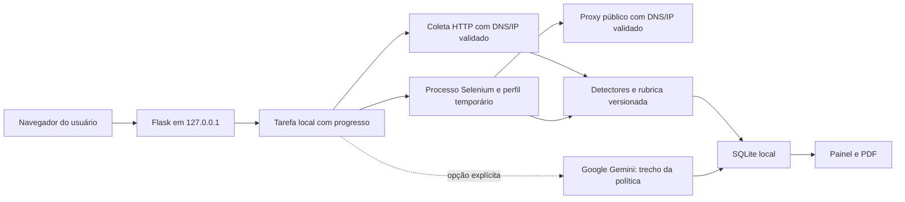

# Arquitetura local 0.2

`Auditoria` aceita coletores injetáveis. Cada coleta gera evidências; critérios independentes calculam a nota e cobertura. A IA pode acrescentar interpretação, mas não muda os estados da rubrica nem a pontuação.

O modo dinâmico renderiza página e política da mesma origem em sessões temporárias separadas. Cada chamada a `SeleniumFetcher` tem processo próprio e prazo. No Windows, o encerramento por prazo atinge apenas a árvore do processo filho criado pela coleta. O proxy limita saída pública e conecta a um IP previamente aprovado. TLS é validado pelo navegador. Downloads não são permitidos.

Os eventos de rede são filtrados pelos frames/loaders do documento atual. Apenas domínios e metadados permitidos dos cookies são mantidos. Eventos brutos, cabeçalhos, valores dos cookies e DOM integral não vão para o SQLite. A captura contém apenas a primeira janela visível da página pública.

O processo Flask mantém uma tarefa de coleta por vez. A interface consulta progresso real; identificadores aleatórios não sequenciais localizam tarefas/resultados. Tarefas são voláteis; histórico é persistente. CSRF e validação de Host protegem o fluxo local; servidor permanece vinculado a loopback.

Gemini usa endpoint fixo, sem redirects/proxies de ambiente, chave no cabeçalho, prazo e limite de resposta. O texto é limitado e parcialmente redigido; comandos na política são tratados como conteúdo. Resposta JSON é validada e citações precisam constar literalmente no trecho enviado. Validação literal não garante a correção da interpretação — permanece necessária revisão humana.

Segredos de UI ficam na memória. Preferências sem chave e o banco ficam em `instance/`, ignorado pelo Git. Esta arquitetura não oferece autenticação multiusuário, isolamento de SO ou declaração de conformidade jurídica.
